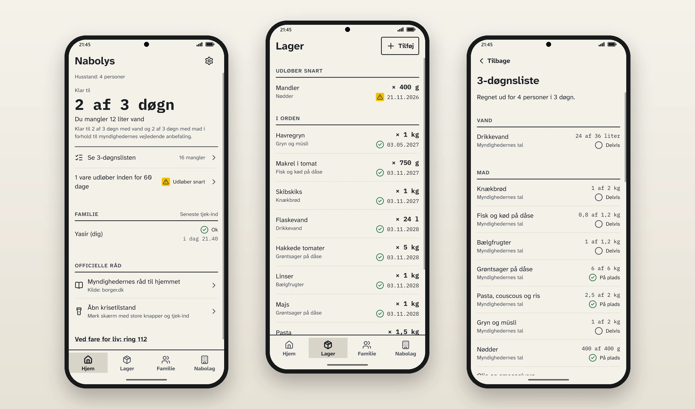
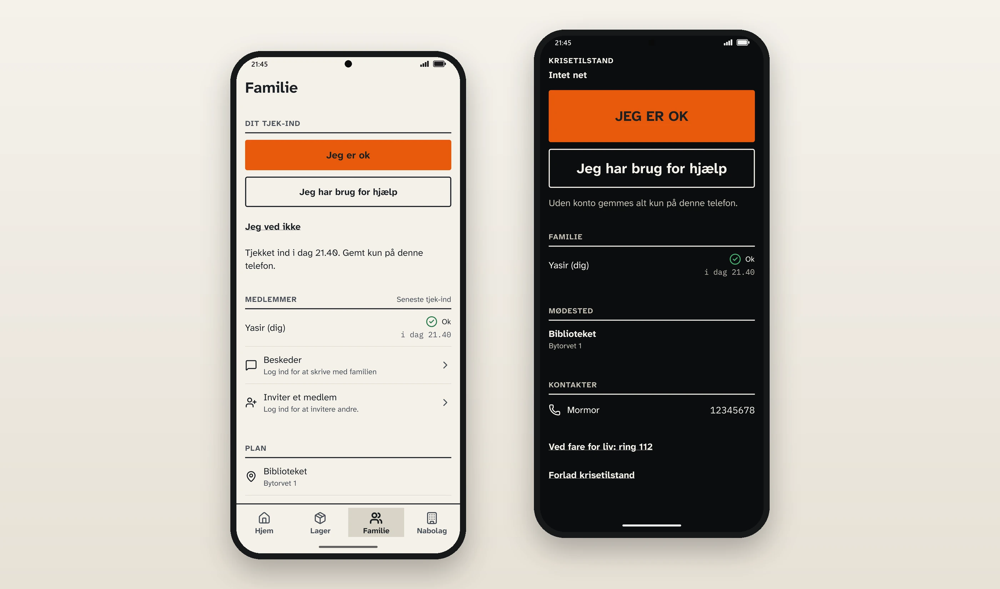

  

  
  
  

> This repository shows the project. The source code is not public. Read more about the app on its website: [nabolys.azurewebsites.net](https://nabolys.azurewebsites.net/).

## What it is

Nabolys ("the neighbours' light") is a Danish app for **Android and iPhone** that helps a family and their neighbours get ready for a crisis and keep in touch when the mobile network or the power is gone.

- **Stock** with best-before dates, and a warning before things expire.
- **A three-day list** worked out for the people who live there (adults, children, small children and pets), based on the Danish authorities' advice.
- **A family plan**: where to meet, who to call and who does what.
- **"I'm ok" check-in** and family messages.
- **Emergency screen**: a dark screen with big buttons, the plan and the latest check-ins.
- **Walkie-talkie**: hold the button and talk to the family near you, phone to phone.
- **Neighbourhoods** (on its way): a closed group for your building or street, where neighbours write to each other.

Nabolys is a private project, not an official app, and it does not replace 112 or official warnings.

## Works without the network

When the network is down, phones near each other can send check-ins, messages and voice over **Bluetooth Low Energy**, also between iPhone and Android, and they are passed on to the server when there is a network again. Everything a family shares is **end-to-end encrypted**, so the server cannot read it. Data on the phone is stored in an encrypted database.

## Status

The MVP is built, and the app is on its way to the App Store and Google Play. Security-related parts get a written internal security review, and every change runs through automated tests and CI. The server and the website run on Azure.

## Screenshots

  
   
  <em>Home, stock and the three-day list</em>

  
   
  <em>Family check-in, the dark emergency screen and the walkie-talkie</em>

## Stack

  
  
  
  
  
  
  
  
  
  
  
  
  
  
  
  

| Part | What it uses |
|---|---|
| **App** (Android, iPhone and web) | React Native with Expo (SDK 58), written in TypeScript. One codebase gives Android, iPhone and a web version. SQLCipher (via expo-sqlite) for the encrypted database on the phone, with the key in the phone's secure storage (expo-secure-store). The camera reads barcodes and QR codes. |
| **Encryption** (`packages/core`) | TypeScript with the @noble libraries: XChaCha20-Poly1305 to encrypt messages, Ed25519 for signatures, HPKE to share keys, and SHA-256. End-to-end encrypted, so the server cannot read the messages. |
| **Bluetooth without the network** | Kotlin on Android, as an Expo module using Bluetooth Low Energy. Swift on iPhone, built and tested in CI. |
| **Server** | C# with ASP.NET Core 10 and Entity Framework Core 10. SQL Server (LocalDB in development, Azure SQL in production). SignalR for real-time messages and online status. Azure Communication Services sends login codes by e-mail. |
| **Operations and tests** | Azure (App Service, Azure SQL, Key Vault and Application Insights), set up with Bicep, and deploys that sign in through Entra ID. GitHub Actions for CI: tests, a scan for leaked secrets (gitleaks) and deploy. EAS Build builds the phone apps in the cloud. |

---

Made by [Yasir Lokman Teksen](https://github.com/Teksen42). More about me on [teksen42.github.io](https://teksen42.github.io).
